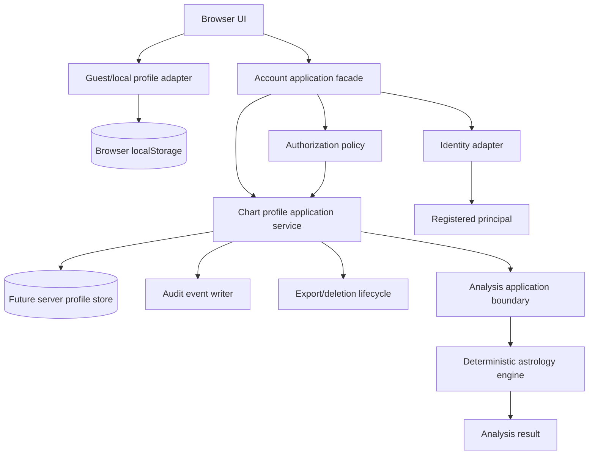

# D04 — Guest, Account and Chart Ownership Architecture

**Status:** Proposed architecture; product/API owner approval required  
**Decision class:** Product and application architecture (no domain-engine change)  
**Supersedes:** No existing approved decision. Refines the unresolved account/cloud-history questions in [Phase 7 accounts and cloud-history decision](../../architecture/phase-7/accounts-and-cloud-history-decision.md).  
**Implementation status:** Design contract only. No authentication, account API, cloud persistence, subscription or account lifecycle is implemented by this ADR.

## 1. Context and verified current state

The current application is a browser-only Vite/React single-page application. The repository does not contain a deployed application backend, account service, authentication provider integration, server database, cloud chart sync, or account entitlement service.

The current chart-profile feature:
- Stores up to 50 profiles in browser/device `localStorage` under `coreastro.chartProfiles`.
- Uses schema version 1, with a recognized version 0 migration.
- Stores profile ID, user-provided label, created/updated timestamps, and a copy of canonical `BirthDetails`.
- Does not store `ProductAnalysis`, report output, or derived astrology in the local profile store.
- Has local list/save/rename/restore/delete/delete-all behavior. A delete removes an entry from this browser store; it does not provide forensic erasure from browser backups, snapshots, or storage media.
- Has no account owner identifier, guest principal, server owner, or cross-device synchronization.

Analysis currently uses request-local/in-memory run snapshots. D02 records version/provenance metadata but does not introduce durable historical input retention or immutable code/dataset archives.

Chart share links currently carry a minimal birth-input payload in a URL fragment. The fragment payload is Base64URL encoded, not encrypted, authenticated, or tamper-proof. Sharing is explicit, excludes name/place-of-birth fields, and the receiver must explicitly load validated inputs. A share link is therefore a bearer-like disclosure of chart inputs, not an authorization grant and not a durable shared chart.

Chart export is a client-side JSON download. It is not an account backup or cloud export.

These are observations of the repository at the time of this ADR. They must be re-verified before a future backend is implemented.

## 2. Goals and non-goals

### Goals
1. Define guest and registered-user concepts without selecting an identity vendor.
2. Define chart profile ownership, multiple profiles, sharing, revocation and access checks.
3. Separate authorization from deterministic astrology calculations.
4. Establish privacy, retention, export, deletion, recovery and device-migration contracts.
5. Define entitlement boundaries without subscription logic in domain calculations.
6. Define safe migration from existing local profiles to registered ownership.
7. Specify approval gates before follow-up implementation work is authorized.

### Non-goals
- Implementing authentication, OAuth/OIDC, password login, sessions, account APIs or a backend.
- Selecting a cloud provider, identity provider, database, billing provider or subscription plan.
- Adding subscription billing or enforcing paid features in the astrology engine.
- Changing chart, Dasha, Career, Wealth, confidence, evidence, synthesis or calculation models.
- Uploading or silently migrating existing local chart data.
- Claiming that browser-local deletion is equivalent to server-side deletion or cryptographic erasure.

## 3. Core architecture principles

1. **Provider-neutral identity:** application services depend on an internal authenticated-principal contract, not a vendor SDK or provider-specific token shape.
2. **Deny by default:** every server-owned resource request is authorized against the resource, action and current policy. An opaque ID is not a permission.
3. **Ownership is not identity:** a user account identifies a principal; a chart profile is a separate owned resource. One account may own many chart profiles.
4. **Guest data remains local until explicit migration:** no upload, account association or background sync without a clear user action and an understandable data preview.
5. **Separate input from derived analysis:** chart profile inputs, analysis snapshots, exports, AI execution records and audit events have distinct retention and access rules.
6. **Minimal personal data:** collect only fields required for a stated feature. Birth details and chart results must be treated as personal/sensitive user data even though no legal classification is asserted here.
7. **Authorization outside the astrology domain:** calculation APIs accept validated domain inputs and explicit calculation options. They do not make account, role, billing or ownership decisions.
8. **Auditable lifecycle:** creation, ownership transfer, sharing, revocation, export and deletion are explicit operations with attributable events.
9. **No implied durability:** local storage, URL sharing and a downloaded file must never be described as cloud backup or cross-device sync.

## 4. Conceptual architecture and trust boundaries

The diagram is a target architecture, not a description of deployed components. The local adapter and current browser profile store exist. The identity adapter, registered principal/session, policy enforcement, server profile store, audit writer and cloud lifecycle services are future components.

### Responsibility boundaries

| Component | Responsibility | Must not do |
|---|---|---|
| Browser UI | Explain guest/account state and request explicit user actions | Treat hidden controls or local state as authorization |
| Guest/local profile adapter | Read/write current device-local profile store | Claim authenticated ownership or remote backup |
| Identity adapter | Validate provider authentication and map it to an application principal | Decide chart permissions or subscription eligibility |
| Authorization policy | Evaluate principal, resource, action, relationship and policy version | Infer access from a client-supplied owner ID |
| Chart profile service | Enforce create/read/update/delete/share/transfer lifecycle | Calculate astrological outcomes |
| Persistence adapter | Store server-owned records and enforce tenant partition constraints | Accept unscoped cross-account queries |
| Entitlement service | Return feature entitlement decisions for a principal/context | Alter domain calculations or synthesize chart outcomes |
| Astrology engine | Calculate from validated inputs and selected methodology | Read auth tokens, accounts, chart owners, roles or subscriptions |

## 5. Guest versus registered identity

### Guest

A guest is an unauthenticated person using the browser application. Guest identity is a local application concept, not a verified person or globally unique identity.

- A guest can use supported local functionality without creating an account.
- Existing local chart profiles remain bound to the current browser storage context, not to a human identity.
- A random local installation/guest identifier may be introduced later for local bookkeeping, but it must not be treated as proof of identity, cross-device identity, or a security principal.
- Guest data may disappear through browser storage clearing, private browsing, browser profile removal, device loss or storage pressure.
- Guest users can export data locally where the current export feature permits it.
- Guest users cannot receive server-side sharing, cloud recovery, or cross-device guarantees until those services exist.

### Registered account

A registered user is an authenticated application principal. The future principal contract should contain:
- `principalId`: opaque, immutable, application-generated subject identifier.
- `status`: `ACTIVE`, `SUSPENDED`, `RECOVERY_PENDING`, or `DELETION_PENDING`.
- `identityIssuer` and a provider subject reference, held only in the identity adapter boundary.
- Authentication assurance / recent-authentication context where needed for sensitive actions.
- Account creation and lifecycle timestamps.

Email address, phone number, display name and provider-specific claims are profile/identity attributes, not primary resource keys. They may change. Do not use email as the owner foreign key.

A principal may be authenticated on multiple devices. A device session is not an owner, and deleting a device session does not delete the account or its chart profiles.

### Identity transition

A guest becomes associated with a registered account only after:
1. The account authentication flow succeeds.
2. The user explicitly chooses to migrate local profiles.
3. The application displays the number and labels of local profiles and explains which birth-input fields will be uploaded.
4. The server validates and accepts each profile.
5. The client receives a per-profile result and only then offers the user a choice to retain or remove the local copy.

A failed, partial or interrupted migration must be resumable and idempotent. It must not silently overwrite cloud profiles with matching labels. Matching labels are not identity. Matching opaque IDs are not proof of common ownership.

## 6. User-owned chart profile model

A future server-owned chart profile is a resource separate from `BirthDetails` and from a calculated chart/analysis.

Proposed conceptual record:

| Field | Contract |
|---|---|
| `chartProfileId` | Opaque, server-generated, immutable identifier; never an authorization secret |
| `ownerPrincipalId` | Required owner principal foreign key, assigned by server from authenticated principal |
| `label` | User-controlled display label with length and content limits |
| `birthDetails` | Validated canonical birth inputs; encrypted at rest using the selected platform's approved controls |
| `schemaVersion` | Explicit schema version; unknown versions fail closed and are not overwritten |
| `createdAt`, `updatedAt` | Server-controlled timestamps |
| `revision` | Monotonic resource revision for concurrent updates |
| `lifecycleState` | `ACTIVE`, `DELETION_PENDING`, `DELETED` |
| `createdByPrincipalId` | Actor who created it, normally the owner |
| `provenance` | Minimal source/migration marker, such as `ACCOUNT_CREATED` or `GUEST_MIGRATION` |

Do not embed subscription plan, billing provider data, auth tokens, refresh tokens, passwords, or provider claims in the chart profile.

### Multiple charts per account

- One registered principal may own zero or more chart profiles.
- Account-level UI lists only profiles authorized for that principal.
- The initial product proposal should allow multiple profiles with a configurable product cap; the actual cap is an entitlement/product decision, not a domain constraint.
- A person may create a profile for a child, partner, family member or another subject. The account owner is the data controller for that profile in the application contract; the subject of birth details is not automatically an account principal.
- Profile labels are not unique and must not be used for resource lookup or permission checks.
- No implicit merge/deduplication of profiles based on birth inputs.

### Ownership transfer

Ownership transfer is a privileged lifecycle operation, not a rename or share operation. It requires explicit confirmation from the current owner, target-account acceptance, recent authentication (or equivalent step-up), audit recording and revocation/replacement of existing grants. If the original owner cannot authenticate, use the account-recovery/dispute process; support staff must not simply edit `ownerPrincipalId`.

## 7. Sharing and access permissions

Sharing is separate from ownership. Proposed initial roles:

| Role | Read chart inputs | Read derived analysis | Edit profile | Manage shares | Delete profile |
|---|---:|---:|---:|---:|---:|
| OWNER | Yes | Yes | Yes | Yes | Yes |
| EDITOR | Yes | Yes | Yes | No | No |
| VIEWER | No by default | Yes, only if separately enabled | No | No | No |

The default share grant should be **analysis-only VIEWER** where a share feature is approved. Sharing birth inputs is a separate, more sensitive permission requiring an explicit field-level scope. An owner may grant a time-bounded role to a specific registered principal. Anonymous public links are not part of the initial recommendation.

Contract requirements:
- Grants are scoped to one chart profile and a specific recipient principal.
- Every read/write request re-evaluates current access; client-side cached grants are hints only.
- The server checks authorization before returning data, including nested analysis/export resources.
- Revocation takes effect for subsequent requests immediately after the authoritative grant is revoked. Short-lived caches must be invalidated or bounded by an explicitly approved maximum revocation delay.
- Revocation prevents future access; it cannot recall screenshots, downloads, previously copied data or data already seen.
- Expiring grants are enforced server-side.
- Role changes and revocation are auditable.
- The owner may revoke any non-owner grant. Editors cannot share or transfer ownership.
- A recipient cannot re-share unless a future explicit delegated-sharing contract permits it.
- Shared export must enforce the same scope as on-screen access.
- Support/admin access is not an implicit role; it requires a separate, approved break-glass policy and audit.

The current Base64URL fragment share link is not this sharing model. It has no authenticated recipient, server-side revocation or confidentiality; it must remain clearly labelled as a user-controlled input-sharing mechanism.

## 8. Subscription and entitlement boundary

Entitlements are application capabilities evaluated outside domain calculations.

Proposed contract:
- The UI may request an entitlement decision for a feature and principal.
- The application/API layer re-checks entitlement on every protected server operation. Hiding a button is not enforcement.
- A decision should include `allowed`, `reasonCode`, `policyVersion`, and optional `limit`/usage context.
- The entitlement service owns plan mapping, trial status, account-level limits, grace period and quota counters.
- The billing provider is an adapter; provider webhooks update an internal entitlement state through verified, idempotent processing.
- Grace periods, cancellation, refunds, failed payments and account suspension require explicit product policy before billing implementation.

Potential entitlement dimensions: number of cloud chart profiles, cloud history retention, AI explanation quota, export scope, sharing capability and collaborator count. These are examples only; no tier, price, cap or paid feature is approved by this ADR.

**Hard boundary:** no domain entity, Dasha resolver, chart calculation, yoga/rule evaluation, C11/CW-05 synthesis, confidence calculation or evidence classifier may branch on account plan, payment status or quota. When a feature is not entitled, the application boundary returns a typed access/entitlement result before invoking the feature. The deterministic engine's output for identical validated inputs and methodology is independent of the caller's subscription.

## 9. Data classification, privacy and security requirements

Treat these classes separately:

| Data class | Examples | Default handling proposal |
|---|---|---|
| Identity/security | Principal ID, provider subject mapping, session metadata, recovery state | Restrict to identity/security services; never send to astrology engine |
| Chart input | Birth date/time, timezone, coordinates, ayanamsa, optional name/place | Minimize, encrypt in transit/at rest, strict owner/share authorization |
| Derived analysis | Chart facts, Dasha periods, evidence, interpretations, reports | Access follows source chart permissions unless a separate export/share scope is approved |
| AI execution | Provider/model/prompt/version/task/time and approved context | Keep distinct from deterministic result; minimize context; do not log raw prompt/input payloads by default |
| Audit/security events | Actor, action, resource, result, timestamp, policy version, correlation ID | Append-only or tamper-evident controls; no raw birth payloads or secrets |
| Billing/entitlement | Provider customer/subscription references, internal entitlement state | Isolated billing boundary; do not expose payment details to astrology engine |

Required controls before server launch:
- TLS for all client/server data flows.
- Encryption at rest for chart inputs and sensitive derived data, with key management and rotation defined by selected infrastructure.
- No birth inputs, full share URLs, access tokens or raw AI context in application logs, analytics, traces, error reports or audit payloads.
- Secrets only in approved secret storage; never in client bundles or repository configuration.
- Rate limits and abuse controls for authentication, account recovery, share grants, export and deletion.
- CSRF protection where cookie-based sessions are selected; secure, HttpOnly, SameSite cookies and explicit origin policy. If bearer tokens are selected, storage and XSS threat decisions must be documented; do not put long-lived secrets in localStorage.
- Input validation and schema-version checks on every server boundary.
- Tenant isolation tests for every repository query and nested resource.
- Dependency/security update process, incident response, breach notification decision tree and operational access review.
- Data-flow and threat-model review before any new data is uploaded.

## 10. Export contract

Account export must be a user-initiated, authenticated operation. Proposed semantics:
- Export includes all active chart profiles owned by the principal and any explicitly exportable analysis/history records covered by the product contract.
- Shared profiles owned by another principal are excluded unless the share grant explicitly permits export; viewer access does not imply export.
- Export includes schema versions, timestamps and provenance needed to interpret records, but excludes authentication secrets, session tokens, internal credentials and unrelated account security data.
- Export format must be documented, versioned, machine-readable and validated before download.
- Large exports may be asynchronous, but download authorization and expiry must be enforced server-side.
- Notify the user of incomplete/unavailable history rather than silently omitting it.
- Export requests and completion are audited without logging exported birth payloads.
- The user can request export before account deletion; deletion UX must not imply that an export is a restorable backup unless tested restore semantics exist.

Current chart JSON export remains a client-generated file for the currently selected analysis. It is not yet a comprehensive account export.

## 11. Deletion, retention and backup semantics

Deletion is a lifecycle workflow, not merely deleting a database row.

### Chart-profile deletion

Upon an authorized delete request:
1. Mark the chart profile `DELETION_PENDING` and immediately deny new access.
2. Revoke all share grants and invalidate active access caches.
3. Remove or schedule deletion of profile inputs and owned derived records according to the approved retention schedule.
4. Propagate deletion to queues, caches, object storage, search indexes, exports under application control and processors that retain copies.
5. Record a minimal deletion audit receipt without raw inputs.
6. Mark `DELETED` after primary-store deletion is confirmed; backup expiration remains tracked separately.

### Account deletion

- Require recent authentication or approved recovery flow and explicit confirmation.
- Suspend new sessions and revoke refresh/session credentials promptly.
- Deny new access while deletion is pending.
- Apply the chart-profile workflow to every owned profile and revoke shares created by the account.
- Define handling of profiles shared *to* the deleting account: access ends; ownership does not change.
- Remove identity mapping and personal account fields when permitted by applicable retention obligations.
- Retain only a minimal deletion/audit tombstone where necessary to prevent accidental resurrection and demonstrate processing; this must not contain birth inputs.
- Provide a clear completion state and disclose any categories retained temporarily and the reason.

### Retention and backups

No numeric retention period is set by this ADR. Before implementation the product/privacy owner must approve a schedule for active records, deleted records, logs, exports, AI records, backups and legal/operational holds. Backup deletion may lag primary-store deletion by a disclosed, bounded period. A restore procedure must reapply deletion tombstones before restored data becomes accessible. Do not promise immediate physical erasure from immutable backups unless the selected platform supports and verifies it.

Browser-local data remains governed by browser/device controls. Local delete removes the app's local store entry but cannot guarantee forensic deletion from snapshots or media.

## 12. Account recovery and device migration

### Account recovery

- Recovery must verify control of the registered identity using the selected provider's supported recovery method plus risk-based step-up for sensitive actions.
- Recovery factors, support escalation, cooldowns, notifications, session revocation and suspicious-change protections require an approved threat model.
- Support staff must not disclose chart content or change chart ownership as part of identity verification.
- A recovery process may restore access to the account; it must not silently migrate, merge or transfer profiles.
- Ownership disputes require a separate documented process and an auditable decision.

### Device migration

- Registered users sign in on the new device and retrieve only resources authorized by the server.
- Guest/local profiles do not automatically follow the user to another browser or device.
- To move guest data, the user uses a validated local export/import or the explicit guest-to-account migration flow.
- Import validates schema version and canonical birth details; duplicate handling is user-visible and never based solely on labels.
- Loss of a guest device can mean permanent loss of local-only profiles. The UI must communicate this limitation.
- Remote sign-out/revoke-device actions should invalidate server sessions; they do not wipe a lost device's local browser storage, so users need a separate local-data safety explanation.

## 13. Guest-to-account migration contract

Migration is an explicit, resumable application workflow:
1. Authenticate and resolve the registered principal.
2. Read and validate the current local profile store without modifying it.
3. Present a migration preview: count, labels, data categories and destination account.
4. Obtain explicit consent to upload the selected profiles.
5. For each profile, send a validated payload to a create operation scoped to the authenticated principal; the server assigns `ownerPrincipalId`.
6. Use an idempotency key per profile migration attempt and a client-generated migration correlation ID. Neither replaces server authorization.
7. Return per-item results: `CREATED`, `ALREADY_MIGRATED`, `REJECTED_VALIDATION`, `FAILED_RETRYABLE`, or `FAILED_FINAL`.
8. Preserve local records after failure. Never delete local copies automatically after a partial migration.
9. After confirmed successful migration, ask whether the user wishes to remove local copies. Local deletion is a separate explicit action.
10. Log migration status and actor/resource identifiers, not raw birth payloads.

Conflict handling:
- Existing account profile labels do not imply equivalence.
- A server-detected idempotency replay returns the original result only when the authenticated principal and migration operation match.
- No cross-account reassignment occurs on conflict.
- Migration from a different guest/browser requires an explicit export/import or other proof-of-possession workflow, not a guessed guest identity.

## 14. Authorization and API contract

Future protected API requests must derive the principal from a validated server-side session/token. The request body must not be trusted to declare the acting principal or resource owner.

Logical operations (illustrative, not implemented routes):
- `POST /chart-profiles`: create an owned profile; server assigns owner from principal.
- `GET /chart-profiles`: return only resources the principal may list.
- `GET /chart-profiles/{id}`: authorize read on the resource.
- `PATCH /chart-profiles/{id}`: authorize edit and enforce revision/concurrency semantics.
- `DELETE /chart-profiles/{id}`: execute deletion workflow.
- `POST /chart-profiles/{id}/shares`: owner-only grant creation.
- `DELETE /chart-profiles/{id}/shares/{grantId}`: owner-only revocation.
- `POST /account/export-requests`: authenticated export request.
- `POST /account/deletion-requests`: authenticated, step-up protected deletion.

Every operation must define authentication requirement, authorization action, input schema, output minimization, idempotency behavior, audit event and error semantics. Unknown/missing principals, deleted resources, stale grants and policy failures fail closed. Avoid revealing whether another user's resource ID exists: unauthorized and nonexistent resource handling should use a consistent externally observable response policy where appropriate.

## 15. Identifiers and data ownership boundaries

| Identifier | Authority | Purpose | Security meaning |
|---|---|---|---|
| `principalId` | Future account service | Registered principal identity | Not secret; not sufficient for authorization |
| `chartProfileId` | Current local service / future server service | Chart profile resource identity | Not secret; not sufficient for authorization |
| `analysisId` | Analysis application service | Analysis result identity/provenance | Not an ownership assertion |
| `selectedPeriodId` | Temporal/product analysis contract | Selected period identity | Not an access token |
| `shareGrantId` | Future share service | Grant management identity | Not a bearer credential |
| `sessionId` | Identity/session adapter | Session lifecycle | Sensitive security metadata; never exposed as a chart identifier |
| `migrationId` | Migration orchestrator | Idempotent workflow correlation | Not proof of ownership |
| `exportRequestId` | Export service | Export lifecycle | Access controlled; downloads require fresh authorization |
| `auditEventId` | Audit service | Event correlation | Not a user-facing permission |

All foreign-key ownership and tenant filters are server-controlled. Client-supplied IDs are selectors only; they are never accepted as proof of ownership.

## 16. Failure and lifecycle semantics

- Authentication unavailable: local guest features remain available where possible; cloud actions fail closed and explain that account services are unavailable.
- Account suspended: block normal chart reads/writes/shares according to approved policy; keep a narrowly scoped route for export/deletion or appeal only if explicitly approved.
- Account deletion pending: deny normal profile access, keep only deletion-status and legally required support flows.
- Entitlement unavailable: protected paid/capped operation fails closed or uses a specifically approved grace policy; calculation engine remains unchanged.
- Share revoked/expired: deny subsequent server requests; do not rely on stale UI.
- Profile schema unsupported/corrupt: do not overwrite with an empty profile list; preserve data and surface a recoverable error.
- Migration interrupted: resume idempotently; leave local source intact.
- Export incomplete: disclose missing categories and allow retry; do not label partial export complete.
- Storage/provider outage: preserve any local data and make no false success claim.

## 17. Audit, observability and retention

Audit events should cover account lifecycle, new device/session, chart create/update/delete, share create/update/revoke, ownership transfer, migration, export request/completion/failure, recovery, entitlement policy changes and privileged support access.

Minimum event envelope:
- Event ID, timestamp, action, actor principal (or `GUEST_LOCAL` marker), resource type/opaque ID, outcome, reason code, correlation ID, policy/version identifier and source channel.
- Never include birth date/time, coordinates, names, complete share URLs, access tokens, passwords, raw AI contexts or full export payloads.
- Restrict audit read access; define tamper resistance, retention and deletion/tombstone treatment before launch.
- Operational metrics should use aggregate counts and latency, not chart-input dimensions or user-level astrology content.

## 18. Migration and rollout plan

### Phase 0 — approval (this ADR)
Obtain product/API/privacy approval of principal semantics, data classes, retention, sharing policy, account recovery and provider selection. No runtime changes.

### Phase 1 — identity and account foundation (future)
Select identity provider and session model; implement provider adapter, application principal, account lifecycle and security controls. Do not migrate local data automatically.

### Phase 2 — server chart profile ownership (future)
Select backend/database and implement tenant-scoped profile CRUD, ownership enforcement, schema/revision management and authorization tests. Keep deterministic engine provider-neutral.

### Phase 3 — guest migration and device sync (future)
Implement preview/consent/idempotency migration, recovery of local imports, multi-device list/read/update and conflict handling.

### Phase 4 — sharing, export and deletion (future)
Only after role policy and retention approvals, implement share grants, revoke propagation, comprehensive account export and deletion workflows with backup-expiry behavior.

### Phase 5 — entitlements (future, optional)
Only after pricing/product decisions, integrate billing adapter and entitlement service at application/API boundaries. Do not modify calculation semantics.

## 19. Approval gates and unresolved decisions

This ADR makes recommended boundaries but does not make the following product decisions on behalf of the owner:

1. Are registered accounts required for any launch feature, or is guest-first still the product direction?
2. Is cloud storage desired, and which chart input/derived record categories may be stored remotely?
3. Which identity provider and session model will be selected?
4. Is the initial share role analysis-only, and is birth-input sharing excluded from v1?
5. Are child/family profiles in scope, and what consent/guardian model applies?
6. What are the actual per-account profile caps and any paid feature boundaries?
7. What exact retention periods apply to active, deleted, audit, AI, export and backup data?
8. What backup-expiry window and restore/tombstone mechanism can the selected platform support?
9. What are the account suspension, dispute, recovery, support-access and ownership-transfer policies?
10. Which data export format/scope and deletion-completion promise will be offered?
11. What privacy/legal review is required for the intended markets and user age groups?
12. Who owns incident response, security operations, processor review and audit-log access?

**Approval rule:** no follow-up auth/account, CRUD, sharing, billing, export or deletion implementation ticket should be treated as implementation-authorized until these decisions are recorded and approved by the product/API/privacy owners. The existing Phase 7 PR-045/PR-046 gate remains in force until then.

## 20. Verification checklist for future implementation

- [ ] Provider adapter returns an application principal; domain packages contain no provider SDK imports.
- [ ] Server derives owner from authenticated principal; client cannot set owner.
- [ ] Every resource operation has an authorization action and fail-closed test.
- [ ] Tenant isolation tests prove cross-account IDs and nested references cannot leak.
- [ ] Multiple profiles per account work without label-based identity.
- [ ] Share grant scope, expiry, revocation and role escalation are tested.
- [ ] Ownership transfer requires acceptance, step-up and audit.
- [ ] Subscription/entitlement checks live at application/API boundaries only.
- [ ] Guest migration requires preview/consent and is idempotent under retry/partial failure.
- [ ] Export scope, partial results, access expiry and sensitive-field exclusion are tested.
- [ ] Deletion covers primary data, derived data, caches, queues, exports, processor copies and backup expiry.
- [ ] Restore re-applies deletion tombstones before reads are enabled.
- [ ] Recovery and lost-device scenarios are threat-modelled.
- [ ] Logs, analytics and traces are checked for prohibited personal inputs/secrets.
- [ ] Privacy, threat model, retention schedule, incident response and operational access are approved.
- [ ] Deterministic calculation golden tests are identical for same inputs/methodology regardless of guest/account/plan.
- [ ] No feature is described as live unless its implementation and operational controls exist.

## 21. Decision summary

Adopt a guest-first, provider-neutral, application-owned principal and chart-profile ownership architecture as the **proposed target**. Keep local chart profiles local until explicit consent and an approved cloud service exist. Model a registered account as an identity principal owning multiple independent chart-profile resources. Enforce sharing, retention, export, deletion and entitlements in application services and APIs. Keep identity, authorization, billing and ownership completely outside deterministic astrology calculations.

This is an architecture proposal only. The current product remains browser-local for profiles, request-local for analyses, and without implemented accounts, cloud ownership, cross-device sync, share permissions, account export/deletion, recovery or subscription entitlements.
