# Gate A — `interpretCareerV2` Production Call Graph

**Baseline SHA:** `b704d146` (frozen; `git log` HEAD at audit time)
**Entry point:** `interpretCareerV2(horoscope, options, observedCareerOutcomes?)` in
`src/domain/career/CareerDomainInterpreterV2.ts` (line 211). Public signature is frozen — this
document records behavior only; no rule, logic, or signature was modified.

Production reachability: `interpretDomain` → `CareerDomainInterpreter.interpret`
(`src/domain/career/CareerDomainInterpreter.ts`) → `interpretCareerV2`, dispatched by
`createDefaultDomainInterpreterRegistry` and invoked from the product analysis pipeline
(`src/product/analysis/productAnalysisService.ts`).

## 1. End-to-end call graph

```mermaid
flowchart TD
    A["interpretCareerV2(horoscope, options, observedOutcomes)<br/>CareerDomainInterpreterV2.ts:211"] --> B["buildCareerNatalAnalysis({horoscope})<br/>careerNatalConvergence.ts — canonical C4–C7 natal"]
    B --> C["buildCanonicalCareerFoundation({horoscope, preComputedInputs, enableDispositorContexts:true})<br/>orchestration/canonicalCareerFoundationBuilder.ts"]
    C --> C1["Upstream chain run once:<br/>careerStructuralReasoningIntegration → careerGraph →<br/>careerHouseNetworks → careerPattern classification →<br/>careerPlanetaryRelevance → careerPlanetaryCondition →<br/>10H/10L foundations → CanonicalCareerOrchestrator"]
    C --> D["careerMechanismCandidates = foundation.resolvedMechanisms[].candidate"]
    D --> E["adaptCareerMechanismRefinements(...)<br/>careerExpression/careerMechanismRefinementAdapter.ts"]
    E --> F["defaultCareerExpressionResolver.resolve({candidates, refinements, 10H, 10L})<br/>careerExpression/defaultCareerExpressionResolver.ts — C8 mechanism resolver"]
    F --> G["adaptMechanismExpressionToLegacy(mechanismExpressionResult, candidates)<br/>careerExpression/mechanismExpressionToLegacyAdapter.ts"]
    G --> H["buildCareerDashaAnalysis({horoscope, natal, expression, dashaInterpretation})<br/>careerDasha/careerDashaIntegration.ts — C9"]
    H --> I["buildCareerD10Analysis({horoscope, natal, expression})<br/>careerD10/careerD10Integration.ts — C10"]
    I --> J["buildCareerFinalAnalysis(canonicalC11Input sans timing)<br/>careerFinalSynthesis/careerFinalSynthesisIntegration.ts — C11 pass 1 (preliminary)"]
    J --> K["mapCanonicalCareerEvidence({natal, expression, dasha, d10, finalSynthesis: preliminaryC11})<br/>canonicalCareerEvidenceMapper.ts"]
    K --> K1["c11Validation cross-check (required/optional/unreferenced)<br/>enforced at acceptance boundary"]
    K --> L["Domain layer: natalPromise, dashaActivation, transitTrigger,<br/>vargaConfirmation(D10), evaluateCareerReasoningHierarchy (CW-01),<br/>careerDashaSynthesis (CW-09), careerTimingSynthesis"]
    L --> M["buildCareerFinalAnalysis(finalCanonicalC11Input with timing)<br/>— C11 pass 2 (authoritative)"]
    M --> N["buildCareerAnalyticalAxes (B01 sibling projection)"]
    N --> O["upstreamSourceRegistry assembly +<br/>validateEvidenceContinuity({evidence, requiredC11EvidenceIds, ...})<br/>evidenceContinuity.ts — throws on invalid (Gate D)"]
    O --> P["buildCareerTrajectory({finalSynthesis: C11, evidence})<br/>careerTrajectory/careerTrajectoryEngine.ts"]
    P --> Q["buildCareerEvents({trajectory, dasha: C9})<br/>careerEvents/careerEventEngine.ts"]
    Q --> R["buildCareerProfessionAnalysis({expressions: C8 result, mechanisms,<br/>10H/10L, canonicalD10, domainEvidence, natalPromiseDirection})<br/>careerProfession/careerProfessionEngine.ts — try/catch, typed failure diagnostic"]
    R --> S["buildCareerOutcomeAnalysis (B02) + buildCareerEventTimeline (B06)"]
    S --> T["Trace/compat adapters: buildCareerReasoningTraceGraph,<br/>legacyShapeForTraceGraph, synthesizeCareerFinal (compat artifact),<br/>synthesizeCareerManifestations"]
    T --> U["buildDomainInterpretation → DomainInterpretation<br/>conclusionData carries canonical C11 + all downstream artifacts"]
```

### Stage detail

| # | Stage | Producer | Output consumed downstream |
|---|-------|----------|----------------------------|
| 1 | Natal foundation | `buildCareerNatalAnalysis` (`careerNatalConvergence.ts`) | `structural`, `relevance`, `condition`, `evidence` → preComputedInputs for foundation; C9/C10/C11 natal layer |
| 2 | Orchestration foundation | `buildCanonicalCareerFoundation` (`orchestration/canonicalCareerFoundationBuilder.ts`) | `resolvedMechanisms` → C8 candidates; `careerFoundationSupplements` (10H/10L) → C8; `mechanismRefinements` → C8; `diagnostics`, `quarantineRecords`, `c8StageDiagnostics` → `internalArtifacts` |
| 3 | C8 expression | `defaultCareerExpressionResolver.resolve` + `adaptMechanismExpressionToLegacy` | `canonicalExpressionAnalysis` (legacy-shaped) → C9/C10/C11; `mechanismExpressionResult` (canonical) → profession engine, upstream source registry |
| 4 | C9 dasha | `buildCareerDashaAnalysis` (`careerDasha/careerDashaIntegration.ts`) | `canonicalDashaAnalysis` → C11, mapper, trajectory/events consumers, outcome/timeline |
| 5 | C10 d10 | `buildCareerD10Analysis` (`careerD10/careerD10Integration.ts`) | `canonicalD10Analysis` → C11, mapper, profession engine (D10 qualification-only) |
| 6 | C11 pass 1 | `buildCareerFinalAnalysis` without `timing` | `preliminaryC11Result` → mapper input, timing synthesis natal strength |
| 7 | Evidence mapping | `mapCanonicalCareerEvidence` (`canonicalCareerEvidenceMapper.ts`) | `evidence` (DomainEvidence[]) → everything downstream; `c11Validation` → acceptance boundary |
| 8 | CW-01 + legacy synthesis inputs | `evaluateCareerReasoningHierarchy`, `buildCareerDashaSynthesis` (CW-09), `synthesizeCareerTransit`/`synthesizeCareerTiming` (`domain/timing/careerWealthTiming`) | `careerTimingSynthesis` → C11 pass 2; `reasoningTrace` (CW-01 versioned) |
| 9 | C11 pass 2 | `buildCareerFinalAnalysis` with `timing` | `canonicalC11Result` — **authoritative conclusion** |
| 10 | Continuity gate | `validateEvidenceContinuity` (`evidenceContinuity.ts`) | throws on invalid — hard acceptance boundary |
| 11 | Downstream consumers | `buildCareerTrajectory`, `buildCareerEvents`, `buildCareerProfessionAnalysis` (fail-soft), `buildCareerOutcomeAnalysis`, `buildCareerEventTimeline` | `conclusionData.*` — additive only, never feed C11 |
| 12 | Presentation adapters | `buildCareerReasoningTraceGraph`, `legacyCareerFinalSynthesis` (compat), `mapC11Manifestations`, `buildDomainInterpretation` | `DomainInterpretation` return value |

## 2. Baseline cross-check vs P2-11G doc

`docs/career/phase2/P2-11G-ORCHESTRATION-PRODUCTION-INTEGRATION.md` records:

- Status header: "IMPLEMENTED — VERIFICATION PENDING … exact SHA `655887ee83bc78b79ad879a4bc0b68be666cb67e`"
- "Latest Changes (Gate 1-5 - Commit `a4eda30bcf563f6f7c6986b5a6c26f0cbbe997ee`)"
- "Test Results (local, commit 655887ee…)" / "Tested Commit SHA: 655887ee…"

The frozen audit baseline is `b704d146`, which is **descendant of both** referenced SHAs
(`git log` shows b704d146 on top of 2ff0b875 → b94fe0ec …). The P2-11G doc's tested SHAs
predate the baseline; all Gate A findings below describe code at `b704d146`, not at
the doc's tested commits. No contradiction found, but golden/acceptance evidence in
that doc does not cover the baseline SHA.

## 3. Legacy / parallel paths inventory

### 3.1 Theme-interpretation rules (`src/engine/themeInterpretation/rules/career/`)

A separate, parallel career evidence system — `interpretCareerTheme`
(`src/engine/themeInterpretation/themeInterpretation.ts`) — evaluates 21 `ThemeRule`s
and produces `CareerThemeInterpretation`. It runs inside `calculateHoroscope`
(`src/engine/astroEngine.ts:596`) and lands on `horoscope.themeInterpretationV2.career`,
consumed by `fullNatalAnalysis` (`src/engine/fullNatalAnalysis/fullNatalAnalysis.ts:446`)
and the theme UI panels. **It is NOT an input to `interpretCareerV2`** — the two systems
share only upstream engine facts (houses, lords, drishti, dasha, divisional charts).

| Rule ID | File | Family | Priority | Concept |
|---------|------|--------|----------|---------|
| CAREER_10H_STRONG_001 | careerHouseRules.ts | TENTH_HOUSE | PRIMARY | Strong/afflicted 10H status |
| CAREER_10H_LORD_AFFLICTION_001 | careerHouseRules.ts | TENTH_HOUSE | PRIMARY | Strong 10H tempered by afflicted lord/occupant |
| CAREER_10H_AFFLICTION_001 | careerHouseRules.ts | TENTH_HOUSE | PRIMARY | Afflicted/challenged 10H |
| CAREER_10H_OCCUPANT_001 | careerHouseRules.ts | TENTH_HOUSE | SECONDARY | 10H occupants shape expression |
| CAREER_6H_SERVICE_001 | careerHouseRules.ts | SIXTH_HOUSE | SECONDARY | 6H service/competition status |
| CAREER_11H_GAINS_001 | careerHouseRules.ts | ELEVENTH_HOUSE | SECONDARY | 11H gains status |
| CAREER_2H_WEALTH_001 | careerHouseRules.ts | SECOND_HOUSE | SECONDARY | 2H wealth status |
| CAREER_6H_10H_LINK_001 | careerHouseRules.ts | SIXTH_HOUSE | SECONDARY | 6H–10H house relationship |
| CAREER_10H_11H_LINK_001 | careerHouseRules.ts | ELEVENTH_HOUSE | SECONDARY | 10H–11H house relationship |
| CAREER_10L_DIGNITY_001 | careerLordRules.ts | TENTH_LORD | PRIMARY | 10L dignity/placement via `evaluateHouseLord` |
| CAREER_6L_10L_LINK_001 | careerLordRules.ts | SIXTH_LORD | SECONDARY | Single lord of 6H+10H |
| CAREER_10L_11L_LINK_001 | careerLordRules.ts | ELEVENTH_LORD | SECONDARY | Single lord of 10H+11H |
| CAREER_SUN_RELEVANCE_001 | careerPlanetRules.ts | SUN | SECONDARY | Sun karaka relevance to 10H/10L |
| CAREER_SATURN_RELEVANCE_001 | careerPlanetRules.ts | SATURN | SECONDARY | Saturn karaka relevance |
| CAREER_MERCURY_RELEVANCE_001 | careerPlanetRules.ts | MERCURY | SECONDARY | Mercury karaka relevance |
| CAREER_MARS_RELEVANCE_001 | careerPlanetRules.ts | MARS | SECONDARY | Mars karaka relevance |
| CAREER_JUPITER_RELEVANCE_001 | careerPlanetRules.ts | JUPITER | SECONDARY | Jupiter karaka relevance |
| CAREER_ASPECT_10H_001 | careerAspectRules.ts | ASPECT | SECONDARY | Graha drishti aspects on 10H |
| CAREER_YOGA_CONFIRMATION_001 | careerYogaRules.ts | YOGA | CONFIRMATORY | Career-relevant yoga participation |
| CAREER_D10_CONFIRMATION_001 | careerVargaRules.ts | D10 | CONFIRMATORY | Legacy D10 confirmation (introductory layer) |
| CAREER_DASHA_TIMING_001 | careerDashaRules.ts | DASHA | TIMING | Active MD/AD/PD lord activation of natal factors |

House-link rules delegate to `detectCareerHouseRelationships`
(`src/domain/career/careerHouseRelationship.ts`) — a domain helper reused by the
theme layer, not a second authority.

### 3.2 Disabled legacy evidence paths (production comments, `CareerDomainInterpreterV2.ts`)

Documented at lines ~179–193 and ~385–412; verified still absent from the active path:

- `buildCareerEvidence(rawEvidence)` (`careerEvidenceMapper.ts:126`) — disabled; was the
  legacy C8/C9/C10-equivalent evidence assembly.
- `toDomainEvidence(structuralReasoning)` (`careerStructuralReasoningIntegration.ts`) —
  imported at line 84 but **not called** in the active path (legacy C4 projection).
- `dashaFactorsEvidence` — disabled legacy dasha-factors evidence.

Canonical replacement: `mapCanonicalCareerEvidence` maps C4–C10 outputs to
`DomainEvidence` with `identityKey` dedup; phases assigned: C4–C7 → `NATAL_PROMISE`,
C8 → `MODIFIER`, C9 → `DASHA_ACTIVATION`, C10 → `VARGA_CONFIRMATION`. C11 is used only
for reference validation.

### 3.3 Test-only / non-production projections

- `options.continuityValidator` injection seam (line 907) — test-only override of
  `validateEvidenceContinuity`.
- `internalArtifacts` block (lines 1235–1262) — canonical artifacts exposed on
  `conclusionData` for the PBA-07 selected-period builder, which is **API-only, not
  wired** (comment lines 346–361: `buildSelectedCareerDashaActivation` is not called
  in production; awaits PBA-07 context).
- Golden/acceptance harnesses (`src/domain/career/__tests__/golden/`,
  `src/integration/stage1/`, `src/acceptance/goldenAcceptanceProductionHarness.ts`)
  invoke `interpretCareerV2` but are test infrastructure, not product path.

### 3.4 Outputs produced but not consumed as authority

| Artifact | Producer | Status |
|----------|----------|--------|
| `conclusionData.careerFinalSynthesis` | `synthesizeCareerFinal` (`careerWealth/finalSynthesis/careerFinalSynthesis.ts:112`) | Legacy compatibility artifact; explicitly **not authoritative** (comment lines 1146–1156). Canonical is `conclusionData.canonicalCareerFinalSynthesis` |
| `conclusionData.careerDashaSynthesis` | `buildCareerDashaSynthesis` (`careerDasha/careerDashaSynthesis.ts:219`, CW-09) | Feeds `careerTimingSynthesis`, AI explanation context, reconciliation trace. Weighted sub-scores (e.g. 6.25/1.50) must never be rendered in dasha UI (comment lines 685–690). Canonical C9 is authoritative for dasha verdicts |
| `reasoningTrace` / `reasoningVersion: 'CW-01'` | `evaluateCareerReasoningHierarchy` + `buildCareerReasoningTraceGraph` | Trace-layer compatibility; conclusion authority is canonical C11 (comment lines 744–745, 1304–1306) |
| P2-11B `CanonicalCareerOrchestrator` | `orchestration/canonicalCareerOrchestrator.ts` | Header comment says it "remains intentionally out of the production synthesis path", **but** `buildCanonicalCareerFoundation` instantiates it to produce `resolvedMechanisms`/supplements. Accurate framing: the orchestrator is a composition artifact inside the foundation builder; its *deferred identity mappings* are out of path |
| `careerAnalyticalAxes` (B01) | `careerFinalSynthesis/careerAnalyticalAxes.ts` | Sibling projection beside C11; does not alter C11 contract or golden snapshots |
| `themeInterpretationV2.career` | `interpretCareerTheme` (theme rules) | Parallel legacy theme system on the Horoscope; not consumed by `interpretCareerV2` |

## 4. D10 verdict section — NEUTRAL-natal label divergence (report only)

**Finding:** `resolveD10Effect` can emit `QUALIFIES`/`CONFLICTS` for a `NEUTRAL`
natal direction, while `hasNatalCareerPromise` rejects `NEUTRAL` before that code is
reached in the production qualification flow.

Code facts at `b704d146`:

1. `hasNatalCareerPromise` (`careerD10QualificationRules.ts:235–252`) returns `false`
   for `natalDirection === 'NEUTRAL'` (line 243) and for `natalStrength ===
   'UNDETERMINED'` (line 247); returns `true` only for SUPPORT / MIXED / CHALLENGE.
2. `resolveCareerD10Qualification` (`careerD10Qualification.ts`) gates in order:
   - `UNAVAILABLE` natal → early `UNAVAILABLE` result (line 160)
   - `!hasNatalCareerPromise(...)` → early `INSUFFICIENT_DATA` result (line 189)
   - `!isD10DataAvailable` → early `UNAVAILABLE` result (line 218)
   - only then `resolveD10Effect(natalDirection, d10Direction, context)` (line 254)
3. `resolveD10Effect` (`careerD10QualificationRules.ts:475–529`) nevertheless contains
   explicit NEUTRAL arms: `NEUTRAL + SUPPORT → 'QUALIFIES'` (lines 520–522) and
   `NEUTRAL + CHALLENGE → 'CONFLICTS'` (lines 524–526). These arms are **unreachable
   through `resolveCareerD10Qualification`** because the line-189 gate returns first —
   they are reachable only via direct calls (unit tests exercise them at
   `careerD10Qualification.test.ts:920`).
4. Label trace when the gate does not fire (natal ∈ {SUPPORT, MIXED, CHALLENGE}):
   `d10Effect` → `resolveCanonicalRelationship` (`careerD10Integration.ts:293–311`):
   `QUALIFIES → QUALIFIES`, `CONFLICTS → CONFLICTS`, `WEAKENS → MODIFIES`,
   `INSUFFICIENT_DATA → PRESERVES` → stored on `CareerD10CanonicalAnalysis.relationship`
   → mapped by `mapCanonicalD10Relationship` (`CareerDomainInterpreterV2.ts:1312–1328`)
   into `VargaConfirmation.relationship` (`QUALIFIES/PRESERVES → PARTIALLY_CONFIRMS`)
   and into C11 input.
5. Per-expression path: `qualifyExpressionSemantically` (`careerD10Qualification.ts:80–142`)
   uses `evaluateDimensionQualification` (dimension-level, not natal-direction-gated
   per se) but is itself only invoked after the line-189 gate, so on NEUTRAL natal
   `expressionQualifications` is `[]` and profession candidates resolve
   `d10Status: 'UNAVAILABLE'`/`'NOT_PROVIDED'`
   (`careerProfessionEngine.ts:800–847`). Where qualifications do exist,
   `applyD10QualificationToCandidates` (same file, ~lines 849–885) derives
   `d10Status`: `CONFLICTED` when any matched qualification has direction CHALLENGE or
   effect CONFLICTS/WEAKENS; `PARTIAL` for MIXED; `QUALIFIED` only when direction is
   SUPPORT **and** at least one qualification has `qualified === true`.

**Net effect:** no production path currently lets a NEUTRAL natal produce a
QUALIFIED/CONFLICTED `d10Status`, because the promise gate precedes both the
`resolveD10Effect` NEUTRAL arms and per-expression qualification. The divergence is a
latent contract inconsistency: the effect table advertises NEUTRAL-natal semantics
that the entry gate makes unreachable. Reported for charter decision; no fix applied.
